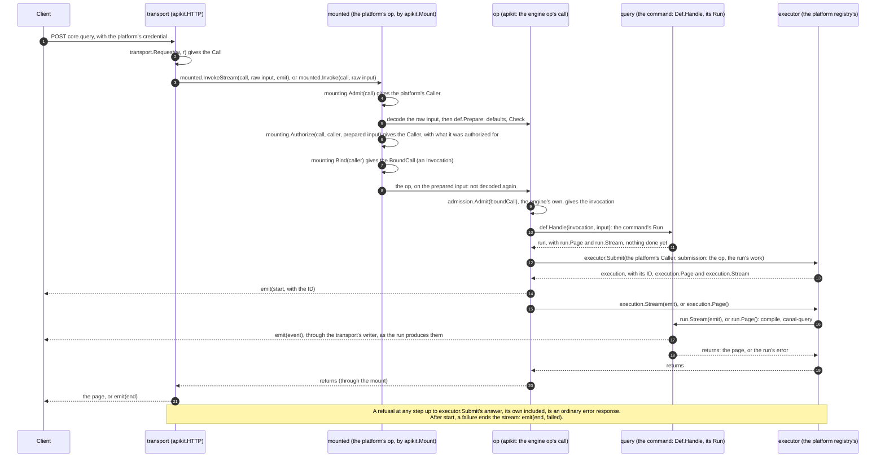
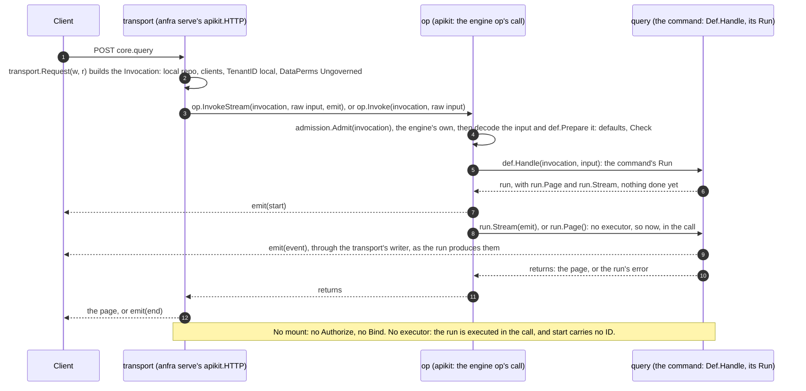

# The engine: anfra as a library

The `engine` package is anfra's public Go API. Any Go program can import it to run anfra in-process: a BI platform, an internal data portal, an agent runtime, a server of any kind. The importing program, the **platform**, brings what anfra deliberately leaves out: who its users are, what each may do, how calls reach it (HTTP, MCP, a queue, a UI of its own), and what it builds around the results. anfra-cloud is one such platform today. The engine is shaped for any of them, not for anfra-cloud in particular.

This doc is the contract between anfra core and its platforms: what the engine promises, what it refuses to do, and what a platform must bring. [usage/engine.md](../usage/engine.md) shows it in code.

## The surface

The public packages are `engine` and `shared/*` (`apperr`, `appstep`, `apptracing`, `apikit`, `httpkit`, `jsonkit`, `requestid`): the error, API and JSON frameworks the engine's operations are built on, which a platform builds its own on too. Everything under `internal/` is not part of the contract and may change in any release.

`engine` is small on purpose (its package comment, `engine/engine.go`, says why). Everything the engine can do is reachable through one call, and the rest of the package exists to build that call:

| | |
|---|---|
| `Connect(ctx, nodeURL, canalQueryURL, …)` | dial the sidecars, which run on their own ([sidecars.md](sidecars.md)) |
| `OpenRepo(dir)`, `ManagedRepo(id, revision)` | the repo to act on: a directory, or a managed repo, which the platform keeps (its git service) and the engine reads at a revision |
| `Governed(attrs)`, `Ungoverned()` | state how the caller's queries may read the data |
| `Dispatch(ctx, inv, req)` | run one command |
| `Ops()` | every command as an `apikit` op (`core.<command>`), to serve as it is |
| `QueryOp`, `ShowOp`, … | refs to the ops a platform authorizes on, with their input types (`QueryRunInput`, …), to mount them by |
| `Describe()`, `Commands()`, `ErrorCodes()` | what there is, for a platform to publish and to test against |

The types (`Request`, `Response`, `Invocation`, `Repo`, `DataPerms`, …) are aliases of the internal ones, not wrappers: nothing converts between them, so nothing can drift.

## What the engine promises

**The same semantics as the CLI.** The `anfra` CLI, `anfra serve` and every platform reach commands through the same registry (`internal/app`) and the same `Dispatch`. A query means the same thing, validates the same way and fails with the same codes wherever it runs. A platform never re-implements a command; it decides who may call it. See [commands-and-api.md](commands-and-api.md).

**A contract a platform can check after every upgrade.**
- `Commands()` lists every command, so a platform that maps commands to its own permissions can fail its build when an upgrade adds one it has not decided on, rather than silently exposing it. anfra-cloud does this (`TestEveryCommandIsDecided`).
- `ErrorCodes()` lists every code `Dispatch` can fail with, so a platform can test that it translates each one.
- `Ops()` carries each operation's name, input and output schemas, codes, and whether it is read-only. A platform that serves them as they are serves the same core API as `anfra serve`, so a client, a Data App or an agent meets one contract on every platform.

**Errors with meaning.** Every failure carries a code, a scope (whose fault it is) and typed details, under the engine's namespace (`engine.Namespace`). A platform translates them into its own codes where it calls the engine (`apperr.Translate`), or imports them as its own (`httpkit.Codes.Imported`). Anything unclassified is an internal error, never a leak. See [errors.md](errors.md).

**Sidecars at the platform's addresses.** `Connect` dials anfra-node and canal-query where the platform runs them, as containers with their own lifecycle, restarts and scaling. It never starts a process: that is how the one-shot CLI works, and the wrong shape for a server. `WithTransport` lets the platform wrap each sidecar's HTTP transport (with `otelhttp`, say), so sidecar calls appear in the platform's traces, without the engine taking a tracing dependency.

## What the engine refuses to do

**Make access decisions.** There is no principal, role or policy anywhere in the engine, and a tenant only as an id it passes on. The platform decides whether a caller may run a command before calling `Dispatch`. What crosses the boundary is the *consequence* of that decision:

- **`DataPerms`**: how this caller's queries may read the data. `Governed(attrs)`: only through the semantic layer, compiled from a dataset with the repo's rules evaluated against the attributes; raw SQL is refused (`DataPermsUnenforceable`), even with no attributes. `Ungoverned()`: raw SQL runs too, and no rule applies. They are decision-bearing: the compiler reads the attributes, and changing one changes which rows come back. They cannot be left unset: `Dispatch` refuses an `Invocation` whose `DataPerms` nobody decided (`DataPermsMissing`), so "ungoverned" is something a platform states, never something it defaults into.
- **The connection's mode**: every statement the engine runs is governed (compiled from a dataset) or ungoverned (SQL as written), and it asks `DataSources.Connection` for a connection in that statement's `DataPermMode`, from one place (`internal/query`'s `connect`). A platform may refuse a mode it did not grant the call on that data source: a second gate, behind its authorization and `DataPerms`, which decide and must be right on their own.
- **`TenantID`**: whom the call runs for, as the platform identifies it. The engine decides nothing by it: canal-query keys its warehouse connection pools by it, so tenants never share a connection, and records it on its spans. A query without one is refused, never run under a shared default.
- **`Attribution`**: who the caller is, for logs, spans and audit. It is baggage and nothing else: no command reads it and it never reaches the compiler. A value that must change the rows belongs in `Attributes`, and the engine keeps the two apart.

`Invocation` is the trusted half of a call: built server-side, never decoded from a request body, or a caller could assert their own permissions. `Request` (a command name and its args) is the untrusted half.

**Grow by accident.** Adding to `engine` is a deliberate act. If a platform needs something from `internal/`, the answer is an issue and a considered addition, not a fork or a reach past the boundary.

## What a platform brings

- **Identity and authorization**: who is calling, and whether they may run this command on this input. `apikit.Mount` gives each op a platform-side `Admit`, `Authorize` and `Bind` around anfra's own validation and handler. `Authorize` reads the input as the op decoded and prepared it (`Def.Prepare`: defaults, normalization, the rules between args), typed by the op's ref (`QueryOp`), and answers the caller `Bind` gets: what the call was authorized for, for `Bind` to build the invocation from.
- **The invocation**: the repo the call acts on, the sidecar clients, the tenant it runs for, the `DataPerms` derived from the caller, and `Attribution` for its logs.
- **The transport**: HTTP, MCP or its own, with its own middleware.
- **The sidecars**: running, reachable, and released with the versions this anfra pins (`manifest.yml`; see [release.md](release.md)).
- **Its own codes and statuses**: either translating the engine's or importing them.
- **Everything around the results**: users, sharing, hosting, history, a UI. That is the platform's product; see [philosophy.md](philosophy.md) for where core stops.

### Serving the engine's ops: directly, or mounted

A platform serves the engine's ops (`Ops()`) in one of two ways. `anfra serve` serves them directly. A platform with callers of its own mounts them (`apikit.Mount`), as an in-process gateway: it admits, authorizes and binds; the op runs as it is. Three types take part, on two sides of the boundary (`Mounting`'s type parameters):

| Type | Is | A platform host, for example | The engine |
|---|---|---|---|
| **Call** | what an op is called with, per call | its credential: a session, the org's slug | its `Invocation` |
| **Caller** | the call, admitted | its user, org, role | the same `Invocation` |
| **BoundCall** | what `Bind` makes of the platform's caller: the engine's own Call | — | an `Invocation`, built by the platform |

**Mounted**, by a platform host with users, orgs and roles of its own:

**Directly**, by `anfra serve`:

- **The engine's registry and admission are the same either way.** Only where the invocation comes from differs: `anfra serve`'s transport builds it from the request; a mounting platform builds it after admitting and authorizing its caller (`Bind`).
- **Only BoundCall crosses the boundary.** The platform's Call and Caller never reach the engine, which takes the invocation as trusted and makes no access decision.
- **The Run comes back across**, and is executed by the platform's registry's executor (`RegistryConfig.Executor`), for the platform's caller: its page taken, or its stream followed. With no executor, it is executed now, in the call.

## Keeping the contract

Changes to anfra core are judged by their effect on platforms:

- An op's name, schemas and codes are the core API. A breaking change to them is declared and versioned ([commands-and-api.md](commands-and-api.md)).
- A new command, error code or `engine` symbol is an addition platforms will see through `Commands()`, `ErrorCodes()` and their builds; that is the intended way for them to notice.
- Nothing about who may do what moves into the engine. If a feature seems to need it, the engine takes the consequence (as `DataPerms` does) and the platform keeps the decision.
