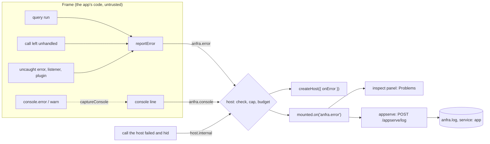

# Errors in a Data App

A Data App is a fourth surface beside the CLI, HTTP and MCP, reached through the SDK rather than one of anfra's doors: its definition calls the core API through the host page, over the bridge ([data-apps.md](../data-apps.md), [sdk-plugins.md](../sdk-plugins.md)). The rules of [errors.md](../errors.md) hold here, with the browser in place of a process. This page is how.

Its readers:

| Reader | Reads | To |
|---|---|---|
| The definition's code | `query.error`, a rejected call | decide what the viewer sees |
| The viewer | only what the code shows | know whether to wait, sign in again or ask |
| The author or coding agent | the inspect panel, `anfra.log` | fix the next try, often with no console |
| The host and its operator | `onError`, `anfra.error` | route runtime errors to their telemetry |

## Goals

1. **An app handles any error the same way, on any host.** One shape (`scope` and `code`), so an app written against `anfra serve` runs on anfra-cloud or a custom host.
2. **Every runtime error reaches whoever can act on it, with the tools they have.** The author in the panel, a coding agent in `anfra.log` without a browser, a host in one callback.
3. **Nothing that is not the viewer's reaches the frame.** No causes, no params, no internal ids; the `requestId` is the one exception, and it is how the cause is found in the log.
4. **One failure breaks only what failed.** Not the other queries, listeners or plugins.
5. **No app floods its host or the log.** A render loop that throws on every frame is capped.

## Principles

| Principle | Applied in |
|---|---|
| **Know who must act.** `scope` says whether the viewer, the app's code or the server must act; an app branches on it first. | [the shape](#the-errors-shape), [handling](#for-an-apps-author) |
| **One shape, decorated, never rewritten.** The API's envelope is the error; the SDK adds to it (`entity`, facts in `message`) and never re-maps it. | [the shape](#the-errors-shape), [backends](#how-a-backend-answers) |
| **Unknown means the server's fault.** What nobody classified is `call_failed`, scope `server`. | [backends](#how-a-backend-answers), [the bridge](#crossing-the-bridge) |
| **The frame's word is not trusted.** Only named fields cross, each capped; a frame cannot claim a host's kind. | [the bridge](#crossing-the-bridge), [runtime errors](#runtime-errors) |
| **Every failure leaves a record where it happened.** An error hidden from the frame is reported by the side that hid it. | [runtime errors](#runtime-errors) |
| **Fail only what failed.** A query's error is stored on the query; a listener or a plugin that throws stops nothing else. | [runtime errors](#runtime-errors) |
| **Report, don't decide.** The SDK is headless: it reports, and the host and the app choose what to show. No default error UI, no wording helper. | [where they go](#where-they-go-per-host), [handling](#for-an-apps-author) |

## The flow

A query's error also stays on the query (`query.error`), and a call's rejection goes to the code that made it: reporting is in addition to the app's own handling, never in its place.

## The error's shape

Every failure of a call is a `DataAppError` (`common/errors.ts`), the document the API answers rather than a class picked for it:

| Field | Always | What |
|---|---|---|
| `scope` | yes | Who must act: `user`, `client` or `server`. |
| `message` | yes | Why, as a sentence safe to show. |
| `code` | yes | What happened: a generic code, or the backend's own. |
| `status`, `details`, `context`, `requestId` | where the backend has them | As in the API's envelope ([errors.md](../errors.md#what-an-error-carries-and-who-reads-it)). |
| `entity` | where known | The query or control it concerns (the SDK's own). |

The one other class is `ValidationError`, for what the definition declares wrong: thrown synchronously at the line that declared it, never from a backend, with the same shape (`declaration_invalid`, scope `client`), so code that reads `scope` and `code` treats every error alike.

A query's error is stored on the query, never thrown: one failed query must not blank the rest.

**Generic codes, for every backend.** A backend that is not anfra's (a host running the SDK over its own API, with an HTTP status and a message but no envelope) cannot speak anfra's codes, so the SDK names the few cases an app must tell apart on any backend. Each reuses an anfra or anfra-cloud code where one exists:

| Code | Scope | Means |
|---|---|---|
| `query_invalid` | user | The query was refused before it ran. |
| `query_failed` | user | It ran, and its data source failed it. |
| `forbidden` | user | This viewer may not see it or do it. |
| `unauthenticated` | user | The viewer's session is gone: sign in again. |
| `invalid_request` | client | The app's call was malformed: a plugin refused it. |
| `declaration_invalid` | client | The definition declared something wrong (`ValidationError`). |
| `connection_failed` | server | The server could not be reached, or its answer was cut or garbled. |
| `call_failed` | server | The host failed the call, for a reason the frame is not shown. |
| `internal_server_error` | server | The server failed. |

Any other code (anfra's `result_too_large` and `page_too_large`, anfra-cloud's own) is the backend's, with its scope. An app that branches on `scope` and the generic codes runs on any host; one that reads a backend's own codes runs best on that host. The SDK's types name the generic and anfra's codes, each with its `details` type, generated from the API's schema.

**Decorated, not rewritten.** Where the facts are in `details` (a refused query's diagnostics, a refused input's fields) and the message is only its code's sentence ("The query is invalid."), the SDK writes them into `message` (`line 1:9: No field x.`), so a message read alone says what is wrong; `details` stays as it came.

## How a backend answers

A backend answers in the shape (`Backend` in `common/types.ts`). anfra's passes the API's envelope through (`api/errors.ts`). One without an envelope maps what it has, by the table the SDK publishes and the helper that applies it (`fromHttpStatus`):

| The backend answered | Code |
|---|---|
| 401 | `unauthenticated` |
| 403 | `forbidden` |
| any other 4xx | the refusal of what was called: `query_invalid` for a query, `invalid_request` by default |
| 5xx | `internal_server_error` |
| nothing | `connection_failed` |
| a rejection with anything else | `call_failed`, scope `server`: unknown means the server's fault |

## Crossing the bridge

The frame runs code anyone may write, so only the SDK's own errors cross with their fields, and only the fields the shape names (`common/endpoint.ts`):

| What | Crosses as | Why |
|---|---|---|
| `code`, `message`, `requestId`, `status` | as they are | the shape |
| `scope` | as it is; one the SDK does not know as `server` | unknown means the server's fault |
| `context` | each step's `text`, never its params | a param can name a dataset or a path |
| `details` | only for a code whose type the SDK knows | anything else is unchecked data |
| any other error (a host bug, a middleware's, a library's) | `call_failed` | its message may hold a URL, a resource's id or a server's error |

**The `requestId` is the one identifier allowed into the frame.** It names a request, not anything in it; the server already sends it to every caller; and only someone who can read the log can turn it into anything. With it, whoever sees the error finds its line in the server's log, where the cause is, shown or not.

Two rules keep `call_failed` rare and findable:

- **The SDK classifies its own failures.** A stream the server cut, or a line in it that is not an event (a proxy's error page), is `connection_failed` saying so (`api/stream.ts`, `api/backend.ts`). What remains `call_failed` is a real bug in the host.
- **A hidden error is recorded where it was hidden.** The host reports the original as a `host.internal` runtime error before answering `call_failed`, and the frame logs one it hides to its own console.

## Runtime errors

What goes wrong while the app runs is reported to its host whether or not anyone inspects it (`app/reporting.ts`, `common/runtimeErrors.ts`), as one event, `anfra.error`. Its `kind` is `<source>.<what>`, in snake_case:

| Kind | What | Reported by |
|---|---|---|
| `call.query` | A query's run ended in `error` (`execute()`), whether or not the app shows it. | the frame |
| `call.<api>` | A call the app made and left unhandled, named as the app called it: `call.fetch_more`, `call.export`, `call.load_options`, `call.lineage`; a plugin's `Anfra.foo.bar()` is `call.foo_bar`. | the frame |
| `app.uncaught` | An uncaught error or unhandled rejection in the frame, a `ValidationError` no one caught included. | the frame |
| `app.listener` | A `subscribe()` listener threw. | the frame |
| `plugin.uncaught` | A failure the SDK caught to keep the app running: a plugin's setup, answer or drawing, a menu item, the menu. | the frame |
| `host.internal` | A call the host failed and showed the frame only as `call_failed`, with the original's message and stack. | the host |

The sources are fixed (`call`, `app`, `plugin`, `host`); the kinds under them may grow. An app or a host branches on the source, and treats a kind it does not know by it. The type says so: `` `${'call' | 'app' | 'plugin' | 'host'}.${string}` ``.

**A call is reported only when no one handles it.** `fetchMore()`, an export, `loadOptions()`, `Anfra.lineage()` and a plugin's own calls reject to the code that made them, so the app handles their errors; reporting them too would report each twice. A rejection the app leaves unhandled is reported by the call's name, as the app called it: the failed call's error notes it, privately, so the shape gains no field. Its `requestId` finds the server's line, which names the op that failed. A query's run is the exception: its error is stored on the query, not thrown, so it is reported either way.

**Fail only what failed.** A `subscribe()` listener is the definition's own code drawing what changed: an exception it throws is reported and stops nothing else, and the query whose change it was told of keeps its result (`app/observable.ts`). A plugin that fails to set up, answer or draw leaves the others, and the app, running.

**The event:**

| Field | When | What |
|---|---|---|
| `kind` | always | As above. |
| `message` | always | Truncated. |
| `code`, `scope` | when it is one of the SDK's errors | Absent for an app's own `TypeError`. |
| `requestId` | when the server answered | Its line in the server's log has the cause. |
| `entity` | when known | The query or control it concerns. |
| `call` | `host.internal` | The call the host failed (`export.query`): the kind says only that it was the host. |
| `stack` | all but `call.*` | Truncated; renamed to the definition's lines (below). |
| `at`, `mount`, `title` | always (`title` if the mount has one) | When, and in which mount. |

Never rows, never a request's params.

**Stacks name the file's lines.** The frame's document is the definition with the SDK put in its `<head>`, so its lines are not the file's. The host rewrites a stack to name the definition's (`definition:107:48`) and the SDK's (`anfra-sdk.js`) in place of the document's (`about:srcdoc:147:48`). The SDK's script is named (`//# sourceURL=anfra-sdk.js`), so its frames read `anfra-sdk.js:9:7875` in a stack and in devtools, where an author can ignore-list it.

**Console lines are not errors.** The app's `console.error` and `console.warn` lines are `anfra.console`, sent only when the host captures them (`createHost({ captureConsole })`), since they can hold the app's data. Unset, a development build of the host's page captures them and a production build does not (`process.env.NODE_ENV`). The SDK's own notes (`anfra: …`) are not sent as console lines: each failure that writes one is reported as an error.

**Limits:**

| Limit | Where | Over it |
|---|---|---|
| `message` 2000 characters, `stack` 4000, other strings 200 | frame, host, and `anfra.log` again | truncated, saying so |
| 120 errors a minute, and 120 console lines apart from them | each frame | not sent; how many, in the frame's console when the minute is over |
| the same, per mount | the host, since a frame can post without the SDK | dropped; how many, on the page's console unless `onError` is given |
| 300 reports a minute per Data App | `POST /appserve/log` | dropped; how many, as `app.reports_dropped` when the minute is over |

The host checks each event (`checkErrorEvent`): a kind not under a known source is refused, a frame cannot claim a `host.*` kind, and only the fields above are kept.

## Where they go, per host

A host receives every mount's errors in one callback, `createHost({ onError })`, and each mount's as `mounted.on('anfra.error')` (console lines as `mounted.on('anfra.console')`). `onError` defaults to the page's console; a host that passes it has said where errors go, so the SDK writes nothing to the page's console, not even how many a mount sent over its budget.

| Host | Errors go to | Console lines |
|---|---|---|
| `anfra serve` (appserve) | the inspect panel, and `anfra.log` | always captured: the panel, and `anfra.log` |
| A custom host | its `onError`, the console unless given | when it captures them |
| A platform (anfra-cloud) | its `onError`: its telemetry, or nowhere | when it captures them |

On `anfra serve`:

- **The panel** lists them among its Problems, with the static ones (markup and wiring found without running the app), errors first. One naming a query or control links to it; any other opens to its stack. Console lines are in a section of their own.
- **`anfra.log`**: the appserve page posts each error and console line to `POST /appserve/log` ([data-apps.md](../data-apps.md#appserve-what-anfra-serve-adds)), which writes it as `"service":"app"` with the app's path as `app`, `event` `app.error` or `app.console`, and the app's own message as `msg` ([logs.md](../logs.md)). Each load of an app starts with an `app.mounted` record, with the file's modification time, so the lines after it are known to be of the file as it was then. An agent reads them without a browser: `anfra status` names the log (`repo.logs`), and an app line's `request_id` finds the server's line with the cause.
- **Opting out**: `ANFRA_NO_APP_LOGS=1` keeps them out of `anfra.log`: the page is told not to send them (`appLogs` in `/appserve/context`), and the route drops any sent anyway. The panel still lists them ([configs.md](../../usage/configs.md)).

## For an app's author

The SDK ships no error UI and no wording helper: an app shows errors its own way. The recipe the build-data-app skill teaches, by scope and code:

| The error | Show |
|---|---|
| `forbidden` | no access |
| `unauthenticated` | sign in again |
| any other `user` or `client` | its `message`: it is about the query or the input |
| `server` | "couldn't load", with a Retry that calls `app.execute()`, which reruns only the failed queries |
| a query `executing` | loading |
| a query `success` with no rows | empty ("No sales this week", never a bare zero) |

Never throw from a listener, and guard a library that may load late.

## Known gaps

Where the code does not follow these rules yet:

- **A Data App's errors say who must act, not whether to retry.** Scope `server` covers both a server that will be back and a bug; nothing yet tells an app to retry.
- **A backend's own message reaches the frame as it is.** The SDK trusts what a backend puts in `message`: anfra's are written to be safe for callers, but another backend's may not be (a job's error log can hold SQL).
- **An error loses its `entity` crossing the bridge.** The frame names it again where it can (a query's error, an export's), not for a plugin's own call.
- **`app.uncaught` is any uncaught error in the frame.** A plugin's own async code (a timer, a promise) and an SDK bug land there with the app's: nothing tells them apart without reading the stack.
- **A plugin's event listener fails silently.** One that throws on a host's event (`kernel.on`) stops no other, but is not reported.

Related: [errors.md](../errors.md) (the rules), [data-apps.md](../data-apps.md) (the SDK and appserve), [sdk-plugins.md](../sdk-plugins.md) (plugins and the bridge), [logs.md](../logs.md) (anfra.log's records).
