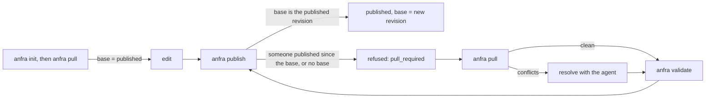

# Publish and pull

> Status: `anfra publish` is built. `anfra pull`, and publish naming its base, are proposed, not built. This is the CLI's side. The org's server, its ops and how it stores repos are the server's own design.

`anfra publish` sends a repo's files to its org, where they replace the published version: all of it, so a file not sent is deleted there ([publishing](../usage/publishing.md)). When two members publish to the same org, the second publish deletes whatever the first added, and neither sees it happen. Today the CLI only warns ("This repo was last published by …") and asks for confirmation, which an agent clears with `--yes`.

This design stops a publish from replacing work it hasn't seen, with two changes that ship together:

1. **A publish names its base,** the org's revision its files were built on. The server refuses it if the org has moved on, so a publish can't replace work it hasn't seen.
2. **`anfra pull` merges the org's published files into the folder,** with a three-way merge against the base ([treemerge](treemerge.md)). Files only one side changed are merged without asking. Files both sides changed get conflict markers, which the member resolves, usually with their agent. After a pull, the published revision is the folder's base, and the next publish goes through.

The refusal is what keeps work safe. Pull is how a member gets past it. Publish doesn't pull by itself, because a pull rewrites the member's files and can leave conflicts, and both should be seen before anything is published. So a refused publish says to run `anfra pull`, which an agent can follow literally.



The same everywhere: pull and publish read the folder's files and anfra's own state, never the folder's git history. A folder that's a git repo behaves exactly like one that isn't ([git in the folder](#git-in-the-folder)).

## The goals it serves

- **G1. No one's published work is replaced unseen, and none is lost for good.** Replacing someone's work always passes through a member, or their agent, having it in front of them, and the org keeps every version.
- **G2. Members only make decisions when there are conflicts.** Otherwise collaborating costs at most one `anfra pull`, and nothing when nobody else published, or the pull would change nothing.
- **G3. Agents can carry the work end to end,** from pulling and resolving to getting ready to publish, asking the member when it isn't clear what to keep.
- **G4. It works for every member, with or without git, and the same wherever it runs.**

When they pull against each other: safety first, then the most convenience safety allows. The explicit pull is what G1 and G2 give together: merging without one would publish work no one has seen. And the member's intent decides what others see: an agent may pull, resolve, take a side and undo a pull, but publishing is the member's call.

## Concepts

- **Published revision:** the version of the repo the org serves now. `repos.status` names it.
- **Base:** the org's revision this folder last matched ([below](#the-base)).
- **Local, org:** the folder's version and the org's. They're `treemerge`'s "ours" and "theirs".
- **Sync state:** what the CLI keeps per org about this folder: the base, and the pending record.
- **Pending record:** the record of a pull that isn't finished: one that's writing files, or left conflicts to resolve.

## The base

The base is the org's revision the folder last matched: the one it last published, or last pulled with no conflicts left. A three-way merge needs it to tell two kinds of difference apart. A file the org has and the folder doesn't could be a file a colleague added, or a file the member deleted. Only the base says which.

The CLI picks it the same way for pull and for publish:

1. **The folder's last sync,** from the sync state.
2. **Otherwise, the published revision, if every publishable file the org has is in the folder, with the same content.** A pull would take nothing, so there's nothing to merge. Files only the folder has are additions, which a publish sends.
3. **Otherwise, no base.** The merge uses an empty one ([treemerge, flow 2](treemerge.md#2-merge-with-no-base)).

Rule 2 covers, with one check:

- **A first publish to a new org.** An org's starting files hold no publishable file, so the rule holds for any folder, and replacing them is the point of a first publish.
- **A folder with files but no base,** such as a `git clone`, that has everything the org has, with or without files added since.
- **A folder that matches the org exactly.**

Rule 2 needs the published revision's file list, read only when the folder has no last sync. Both rules run in one step, after reading the published revision and before anything is uploaded.

## Starting a folder

A folder without a base is a folder starting out: a new member, a new machine, a fresh clone, or a copy.

**`anfra init`, then `anfra pull`,** is how to join an org's existing repo. `init` writes no publishable file (`.anfra/`, `.gitignore`, `AGENTS.md`, and a `.gitkeep` in each empty folder), and neither do an org's starting files. So a folder fresh from `init` pulls with no base and gets no conflicts: every one of the org's files is added, and the published revision becomes the base.

```
$ anfra init acme
✓ Set up an anfra repo in acme, with 8 files.
Put your database in acme/.anfra/data_sources.yml, write models and datasets, then run `anfra validate`.
To work on a repo an org already has, run `anfra pull` in acme.

$ cd acme && anfra pull
? Which org? https://cloud.example.com/o/acme (signed in)
✓ This repo publishes to https://cloud.example.com/o/acme (.anfra/config.yml org.url).
✓ Pulled acme@4c1d07e from https://cloud.example.com/o/acme: added 42 files.
```

- **The install instructions and the skills say so:** `anfra init` to start a new repo, `anfra init` then `anfra pull` to work on one an org already has. The skills give agents `anfra pull --set-org <org>`, since an agent usually runs without a terminal.
- **`init` hints about pull,** as above.
- **Pull chooses the org as publish does.** With no org set, on a terminal, it offers the saved logins and signing in to a new one, then saves `org.url`. `--set-org` names the org directly. Without a terminal and with no org set, pull fails and names `--set-org`.
- **Pull needs an anfra repo,** a folder `init` set up. Elsewhere it fails and says to run `anfra init` first, so a mistaken pull, in a home folder say, can't scatter `.aml` files into it.

**Each command writes its own files.** `init` writes only local files, which a publish never sends. `pull` writes only publishable files, plus `org.url` when it chooses the org. So local files never reach the org, and the org's files never mix with local setup. A test keeps `init`'s files free of publishable ones.

### A folder with files but no base

| How the folder got here | Has files | Has a base |
|---|---|---|
| `anfra init`, then `anfra pull` | Yes | Yes |
| `git clone` | Yes | No |
| A colleague's copy of their folder | Yes | No |
| A copy made without `.anfra/publish/`, or one whose state was deleted | Yes | No |

For every "files, no base" row:

- **If every file the org has is in the folder, unchanged,** the published revision is the base (rule 2), and the member edits and publishes normally. A clone of a team that commits what it publishes is usually here.
- **Otherwise, every file that differs is a conflict.** Without a base, anfra can't tell which version is newer: the org may be ahead, or the folder, file by file. Publishing as it is could replace the org's newer work, so publish refuses, and pull marks each differing file.
- **Each conflict takes one decision, which version is right,** made per file with `anfra pull --take org` or `--take local`. In a git folder, `git log -- <path>` usually tells which is newer. Without git, the member decides from what they know ("this copy is from last week").

A pull with no base says so: "This folder had no record of the org's files, so anfra can't tell which version of each differing file is newer. Pick one per file with `anfra pull --take org <path>` or `--take local <path>`." Files the org has and the folder doesn't are listed as "restored", since they may be files the member deleted.

## Components

```
 anfra pull, anfra publish     the commands: run the flows, write the output
 ─────────────────────────────────────────────────────────────────────────────
 syncstate   the sync state: base, pending record, lock
 workdir     the folder ⇄ tree: select and hash files, apply a merge safely, back up, restore
 remote      the org's server ⇄ tree: the published revision, file lists, file contents
 ─────────────────────────────────────────────────────────────────────────────
 treemerge   the merge itself (pure): three trees in, a result out
```

| Component | Owns | Doesn't |
|---|---|---|
| `syncstate` | Reading and writing the sync state per org, its lock, its folder's `.gitignore`, moving `published.json` into it | Deciding anything about files |
| `workdir` | Which files are the repo's (`repoformat.Publishable`), hashing them, refusing a file that's on disk but not selected, checking paths before writing, writing through temporary files, the backup, restoring it | Merging |
| `remote` | `repos.status`, `repos.list_files`, `repos.get_blobs`, batching within the server's limits, a blob reader over them | Anything about the folder |
| `treemerge` | Deciding the merge, conflicts and markers, checking resolution, taking a side ([treemerge](treemerge.md)) | Files, the network, the sync state |
| The commands | The flows below, choosing the base, refusals, output | |

## The sync state

Kept in the repo, in `.anfra/publish/`, which never reaches git:

```
.anfra/
  config.yml                  committed
  data_sources.yml            git-ignored: credentials
  publish/                    never committed: its own .gitignore holds `*`
    .gitignore
    state.json                per org: the base, and the pending record
    lock                      held while a pull or publish runs in this folder
    backup/                   an unfinished pull's backup, by blob id, for --abort
```

Unlike anfra's other state, which lives in `ANFRA_HOME` ([philosophy](philosophy.md#dont-bloat-the-users-machine-or-repo)), the sync state stays true with the repo's content: it says which org revision these files match, wherever they are. So it travels with them. A moved or renamed folder keeps its base, and a copy carries the base its files really match. It can't be rebuilt from the files, and losing it costs a pull full of conflicts.

`state.json`, per org:

```json
{
  "https://cloud.example.com/o/acme": {
    "base": "acme@8f3a91c…",
    "pending": {
      "revision": "acme@4c1d07e…",
      "state": "conflicted",
      "conflicts": [
        {"kind": "content", "files": [{"path": "datasets/sales.aml", "base": "…", "local": "…", "org": "…"}], "marker_size": 7},
        {"kind": "binary", "files": [{"path": "apps/logo.png", "base": "…", "local": "…", "org": "…"}]}
      ],
      "before": {"datasets/sales.aml": "…", "models/refunds.aml": ""}
    }
  }
}
```

- **`base`** is written after a publish, after a pull with no conflicts, and when a pull's conflicts are found resolved.
- **`pending`,** the pending record, exists only while a pull writes files (`writing`), or until its conflicts are resolved (`conflicted`). Each conflict is `treemerge`'s: its kind, paths, blob ids and marker size, so `--take` and the resolution check need nothing else.
- **A conflict** lists every path it covers with its three versions, since one conflict can cover several (`file_folder`, `path_collision`). `resolved` is set when a side is taken. A conflict with markers is resolved by its file's content, checked each time.
- **`before`** is each path the pull wrote or deleted, with its blob id before the pull, `""` for one the pull created. Undoing the pull, or `--take local`, puts these back.
- **The backup** is `.anfra/publish/backup/`, each file named by its blob id, never by its path: anfra-node reads every `.aml` file under the repo, dot folders included, so a backup named `models/orders.aml` would be compiled with the repo.
- **`lock`** is held by a pull or publish for as long as it runs, so two in one folder don't interleave. A second one fails at once, saying another is running. The system releases it when the process ends, so a crash never leaves it held.
- **On first run,** the revision in `ANFRA_HOME`'s `published.json` becomes `base`, and that file is removed.
- **`.anfra/publish/` ignores itself:** its own `.gitignore` holds `*`, as pytest's cache folder does, so nothing in it is committed, whatever the repo's own `.gitignore` says. `.anfra/` as a whole can't be ignored, since it holds committed config.
- **Recording the base is best-effort,** as recording `published.json` is today. In a folder that can't be written, such as a read-only mount, a publish still goes through, and the next one finds its base with [rule 2](#the-base). A pull can't run there anyway, since it writes the files.

```
                 pull: nothing to write, or a clean pull
              ┌─────────────────────────────────────────┐
              ▼                                         │
        ┌──────────┐  pull starts writing   ┌──────────┐│
   ───▶ │ synced   │ ─────────────────────▶ │ writing  ││
        │ base = R │                        │          ││
        └──────────┘ ◀──── --abort ──────── └────┬─────┘│
          ▲   ▲ │ publish                        │ written, with conflicts
          │   │ └──▶ synced, base = new revision │      │
          │   │                                  ▼      │
          │   │      every conflict resolved ┌──────────┤
          │   └───────────────────────────── │conflicted│
          │      (base = the pull's revision)│          │
          └──────────── --abort ──────────── └──────────┘
```

While `writing` or `conflicted`, publish refuses and pull refuses to pull again. `writing` only lasts while a pull runs, so finding it means the pull was killed, and only `--abort` gets out.

## Flows

### 1. Checking resolution

The first step of every pull and publish.

1. `syncstate`: read the pending record. With none, carry on.
2. If it's `writing`, refuse, and say to run `anfra pull --abort`.
3. For each conflicted file, `treemerge.Resolved` with the file's current content ([treemerge, flow 4](treemerge.md#4-check-whether-a-conflict-is-resolved)). A deleted file is resolved. A binary conflict is resolved only by `--take`.
4. All resolved: the pull's revision becomes the base, the backup is deleted, the record dropped. Otherwise refuse, naming the files.

### 2. Pull

1. `syncstate`: lock, then [flow 1](#1-checking-resolution).
2. `remote`: read the published revision. **Pick the base** ([above](#the-base)). If it's the published revision, the folder is up to date.
3. **Build the three trees:** the folder's (`workdir`, refusing a file on disk that isn't selected), the base's and the published revision's (`remote`). Paths the org has that aren't publishable, such as a starting `.gitignore`, never appear: `repos.list_files` lists only publishable files.
4. **`treemerge.Merge`** ([treemerge, flow 1](treemerge.md#1-merge-three-trees), or [flow 2](treemerge.md#2-merge-with-no-base) with no base), with `remote` and the folder as its blob reader, and the labels "local" and "org".
5. **`workdir.Apply`:** check every path ([below](#writing-files-safely)), back up each file that will change, write the pending record as `writing`, write each file through a temporary file and a rename, delete the files to delete.
6. **`syncstate`:** with no conflicts, the base becomes the published revision and the record is dropped. Otherwise the record becomes `conflicted`.
7. **Report** the changes and conflicts ([what members see](#what-members-see)).

### 3. Resolving by editing

How a member, or their agent, resolves the conflicts a pull left. anfra takes no part until the next command: resolution is read from the files ([flow 1](#1-checking-resolution)).

1. **See what's conflicted.** The pull's output lists each conflict, its kind and what to do. Later, the same list comes from a refused publish, or from `anfra publish status` ([below](#seeing-the-conflicts-again)).
2. **Resolve each file, by its kind:**
   - **`content`, `add_add`:** edit the file. Each conflict shows the local version, the base and the org's, between markers. Keep the right result, and remove the markers.
   - **`modify_delete`, `delete_modify`:** the whole file is between markers. Delete the file to keep the deletion, or remove the markers to keep the changed version.
   - **`binary`, and the kinds without markers (`rename_rename`, `rename_delete`, `file_folder`, `path_collision`):** pick a side with `anfra pull --take` ([flow 4](#4-taking-a-side-anfra-pull---take-orglocal-path)).
   - **When it isn't clear which change to keep,** the agent asks the member. The skills say so, and the pull's hints say so to an agent reading them.
3. **Check the result** with `anfra validate`. A file can be free of markers and still be invalid AML, such as a measure kept from both sides.
4. **Publish,** or pull again. Either runs [flow 1](#1-checking-resolution) first: with every listed file resolved, the pull's revision becomes the base, and the command carries on. With some left, it refuses, naming them.

Resolving can be spread over several sessions and agents. Nothing is held open between commands: the pending record and the files are the whole state.

#### Seeing the conflicts again

Resolving often isn't done by whoever saw the pull's output, or not all at once:

- **A new agent session.** The member pulls with one agent, gets conflicts, and stops. The next day, another session is asked to finish the merge, and never saw the output.
- **A hand-off.** The member pulls in their own terminal, and asks their agent to resolve the conflicts.
- **A long resolution.** The agent resolves some files, then loses track, after its context was compacted say, of which are done.
- **Checking progress.** The member wants to know what's left, and the output in their terminal doesn't show what's been resolved since.

Each needs the conflicts listed again, with what each needs, and the obvious ways don't do it:

- **Publishing to find out is unsafe.** If everything happens to be resolved, the publish doesn't report: it publishes, work that may not have been reviewed or validated.
- **Searching for markers misses conflicts.** It finds text conflicts, but not binary ones or the kinds without markers, which need `--take`. It can't tell that a deleted file was a resolved `modify_delete`, and it can find marker-like lines that aren't conflicts.
- **The kind decides what to do:** edit, delete, or take a side. Only the pending record has it.

So two commands list them, without publishing, following anfra's convention that `status` describes and `check` judges ([todo](../todos/publish-status-and-check.md)):

- **`anfra publish check`,** the preflight, reports unresolved conflicts as a failing step, listing each with its kind. It exists, so this is the first to build.
- **`anfra publish status`,** planned, shows the sync state: the base, whether the folder is behind, and each conflict of the pending record, resolved or not, with its kind.

### 4. Taking a side: `anfra pull --take org|local <path>...`

1. `syncstate`: lock, read the pending record, check each path is in a conflict.
2. **org:** `treemerge.Take` gives the org's version of the conflict's paths, written or deleted from the org's blob ids through `remote`. **local:** the folder's version, restored from the backup, which undoes edits made to it since the pull.
3. The conflict is resolved, then [flow 1](#1-checking-resolution)'s step 4.

### 5. Undoing a pull: `anfra pull --abort`

1. `syncstate`: lock, read the pending record, `writing` or `conflicted`.
2. `workdir`: restore every backed-up file, delete the files the pull added.
3. `syncstate`: drop the record. The base is unchanged.

Many folders aren't git repos, and uncommitted work isn't in git anyway, so the backup is what makes a pull safe to run. Aborting after editing a file loses those edits too, and the command says so at a terminal before it runs.

### 6. Publish

What changes from today's flow, in order:

1. `syncstate`: lock, then [flow 1](#1-checking-resolution).
2. `workdir`: select and hash the files, refusing a file on disk that isn't selected.
3. Authenticate and validate, as today.
4. `remote`: read the published revision, and **pick the base.** If it's the published revision, carry on. Otherwise, before uploading anything, **ask whether a pull would change the folder** ([below](#when-a-pull-would-change-nothing)):
   - **It would:** refuse with `pull_required`.
   - **It wouldn't:** the org's changes since the base are already in the folder. Carry on, with the published revision as the base, and say so in the output.
5. Upload the missing blobs, as today, and publish with `base`. If the server answers `base_outdated`, someone published in between: refuse with the same `pull_required`.
6. `syncstate`: the base becomes the new revision.

#### When a pull would change nothing

Refusing for a pull that would do nothing is a step that protects no one's work, so publish skips it ([G2](#the-goals-it-serves)). The question "would a pull change the folder?" is `treemerge`'s classification alone ([treemerge, flow 7](treemerge.md#7-classify-without-merging)):

1. `remote`: list the base's files and the published revision's (`repos.list_files`). The folder's are already hashed.
2. `treemerge.Classify(base, folder, published)`, by blob id only, no file contents read.
3. A pull would change nothing when every path is `unchanged` or kept as the folder has it. Any path the pull would take, merge, or mark as a conflict means it would change something.

| Since the base, the org… | And the folder… | A pull would… | Publish |
|---|---|---|---|
| Changed `orders.aml` | Got the same change, through `git pull` say | Change nothing | Goes through |
| Added `refunds.aml` | Doesn't have it | Add it | Refused |
| Deleted `legacy.aml` | Still has it, unchanged | Delete it | Refused. Publishing would bring it back |
| Changed `sales.aml` | Changed it differently | Merge it | Refused |

With no base, the same check runs from an empty base, which is [rule 2](#the-base). It costs two file-list calls (paths and blob ids, no content) only when the folder is behind. The base's list isn't kept in the sync state: fetching it is simpler than keeping state that could go stale.

The "last published elsewhere" warning and its confirmation go away, since the refusal replaces them. `--yes` has nothing left to confirm, so it's kept for a release with a warning that it does nothing, then removed. There's no `--force`: a member who wants to remove a colleague's work pulls it, deletes or edits those files, and publishes, so the removal is a choice made after seeing them. `anfra publish check` runs steps 1, 2 and 4, and reports a refusal as a failing step.

### 7. Starting a folder

`anfra init`, then `anfra pull`, which chooses the org and runs [flow 2](#2-pull). With no base and no publishable files, every file is added and nothing conflicts ([above](#starting-a-folder)).

## Writing files safely

- **Paths from the server are untrusted.** Before writing anything, `workdir` refuses a path that isn't publishable, is absolute, contains `..`, or leads through a symlink in the folder. Pull writes only inside the repo's folder, and only files a publish would send.
- **And the system enforces it.** Every read, write, rename and delete goes through an `os.Root` opened at the repo, or at the backup, so none can leave it, by `..` or by a symlink, even one made between the check and the write.
- **Selected versus present.** A file on disk that's in the base or the published revision but isn't selected (a symlink, or a file a newer anfra no longer publishes) makes pull and publish stop and name it. Otherwise the merge would read it as deleted, and the next publish would delete it from the org.
- **The merge is worked out in memory** by `treemerge` before any file is touched.
- **Each file is written to a temporary file and renamed into place,** after the backup and the pending record are written. A pull that's killed partway leaves `writing`, and `--abort` restores from the backup whatever was written.
- **Two commands in one folder don't interleave:** pull and publish hold the sync state's lock (`.anfra/publish/lock`). A second one fails at once, saying another is running, rather than waiting behind an upload. The lock goes with the process, so a crash never leaves it held.

## What the CLI needs from the org's server

The CLI relies on these ops of the org's API, which the server defines:

| Op | The CLI uses it for |
|---|---|
| `repos.status` | The published revision, who published it and when, and the server's limits |
| `repos.list_files` | A revision's files, as paths and blob ids: the base's and the published revision's |
| `repos.get_blobs` | File contents by blob id, in batches within the server's limits: only for files the pull takes or merges |
| `repos.list_missing_blobs`, `repos.create_blobs` | Uploading, as today |
| `repos.publish`, with `base` | Publishing only if the published revision is still `base`. Otherwise the server answers `base_outdated`, with who published and when |

**This needs a server that has these ops.** No attempt is made to work with an older one: there, pull and publish fail with the server's own error, such as an unknown field or op. The server takes them before a CLI that uses them is released.

## What members see

Pull's result follows the pretty-output conventions ([cli-pretty](cli-pretty.md)): `--yaml` and `--json` for agents and scripts, and the same fields drawn for a person at a terminal.

- **`conflicts`** groups the conflicts by kind, each with the paths it covers and a message saying what happened, naming its files. A kind is `treemerge`'s code, with ours as local and theirs as the org, so a program can branch on it.
- **`how_to_resolve`** says, once per kind present, how to resolve that kind. The same key leads to both: `conflicts.content` and `how_to_resolve.content`.
- **`hints`** say what's true of every conflict: `--take` can resolve any, then validate and publish, or undo the pull.

A pull with conflicts, at a terminal:

```
Pulled the changes bob@acme.com published on 2026-11-08 at 16:20 (acme@4c1d07e). 3 conflicts, of 3 kinds, to resolve.

Revision:      acme@4c1d07e
Published by:  bob@acme.com
Published at:  yesterday
Base:          acme@8f3a91c

Changes:
  PATH             CHANGE
  models/new.aml   added

Conflicts:
  binary:         You and the org both changed apps/logo.png, a binary file.
  content:        You and the org changed the same lines of models/a.aml.
  modify_delete:  You changed models/old.aml, and the org deleted it.

How to resolve:
  binary:         These files can't hold conflict markers. Keep one version with --take.
  content:        Edit each file to keep the right changes, and remove the conflict markers.
  modify_delete:  Delete the file to keep the deletion, or remove the conflict markers to keep your version.

Hints:
  To keep one version of whole files, run `anfra pull --take local <path>...` for yours, or `--take org <path>...` for the org's. It can resolve any conflict.
  Once every conflict is resolved, run `anfra validate`, then `anfra publish`.
  To undo this pull, run `anfra pull --abort`.
```

On a terminal too narrow for a section's lines, each value goes under its label instead. The same with `--yaml`:

```yaml
message: Pulled the changes bob@acme.com published on 2026-11-08 at 16:20 (acme@4c1d07e). 3 conflicts, of 3 kinds, to resolve.
org: {url: https://cloud.example.com/o/acme, name: Acme}
revision: acme@4c1d07e
published_by: bob@acme.com
published_at: 2026-11-08T16:20:00Z
base: acme@8f3a91c
changes:
  - {path: models/new.aml, change: added}
conflicts:
  binary:
    - {paths: [apps/logo.png], message: "You and the org both changed apps/logo.png, a binary file."}
  content:
    - {paths: [models/a.aml], message: You and the org changed the same lines of models/a.aml.}
  modify_delete:
    - {paths: [models/old.aml], message: "You changed models/old.aml, and the org deleted it."}
how_to_resolve:
  binary: These files can't hold conflict markers. Keep one version with --take.
  content: Edit each file to keep the right changes, and remove the conflict markers.
  modify_delete: Delete the file to keep the deletion, or remove the conflict markers to keep your version.
hints:
  - To keep one version of whole files, run `anfra pull --take local <path>...` for yours, or `--take org <path>...` for the org's. It can resolve any conflict.
  - Once every conflict is resolved, run `anfra validate`, then `anfra publish`.
  - To undo this pull, run `anfra pull --abort`.
```

Conflict kinds, and how each is resolved:

| Kind | What happened | Resolved by |
|---|---|---|
| `content` | You and the org changed the same lines | Editing the file and removing the markers, or `--take` |
| `add_add` | You and the org both added the file, differently (or, with no record of an earlier sync, it differs) | The same |
| `modify_delete` | You changed the file, and the org deleted it | Deleting it, or removing the markers to keep it, or `--take` |
| `delete_modify` | You deleted the file, and the org changed it | The same |
| `binary` | You and the org both changed a binary file | `--take` only: it can't hold markers |
| `file_folder` | A path is a file on one side and a folder on the other | `--take` only |
| `path_collision` | Two paths would be one file on systems that ignore case | `--take` only |

A clean pull ends with "Run `anfra validate` to check the merged files, then `anfra publish`." A pull with nothing new: "This folder already has everything published to Acme (acme@4c1d07e)." `--take` answers which conflicts it resolved (`taken`) and those left, and `--abort` the files it put back (`restored`).

A pull with conflicts exits 0: the conflicts are part of its result ([philosophy](philosophy.md#make-interfaces-work-for-agents-and-programs-not-only-people)). A pull that couldn't run exits non-zero:

| When | Code |
|---|---|
| The last pull's conflicts are unresolved | `conflicts_unresolved`, its details naming the files |
| The last pull stopped partway through writing files | `pull_interrupted` |
| Not an anfra repo, another pull or publish running, a file anfra won't read as deleted | `precondition_failed` |
| No org, no terminal | `org_not_set` |
| `--take` on a path with no conflict, or a side other than `org` or `local` | `validation_failed` |

A publish that goes through although someone published since, because their changes are already in the folder:

```
$ anfra publish
✓ bob@acme.com published to https://cloud.example.com/o/acme on 2026-11-08 16:20, and their changes are already in this folder.
✓ Published 42 files to Acme, as revision acme@91b2e4f.
```

Refusals:

```
✗ Not published, because bob@acme.com published to https://cloud.example.com/o/acme on 2026-11-08 16:20, after this folder last pulled or published. Run `anfra pull` to merge their changes, then publish again.

✗ Not published, because datasets/sales.aml still has conflict markers from `anfra pull`. Resolve it, or run `anfra pull --abort`, then publish again.
```

## Git in the folder

anfra doesn't read git, but git helps a member see what anfra did:

- **A pull writes into the working tree,** so its changes show in `git diff`, mixed with uncommitted work. When the working tree has uncommitted changes, pull suggests committing first, so the pull's changes can be told apart. After a pull, the member commits the result.
- **`git log -- <path>`** tells which version is newer when a folder with no base has conflicts.
- **Switching branches doesn't change the base.** Publishing from `main` after publishing from `feature` replaces the org's files with `main`'s, as today, including files only `feature` had. Pull and publish see only the folder's files, and the org keeps the history of what was replaced.

Teams that share through git and publish from CI need publishing driven by git itself, which this design doesn't cover.

## Later

- **Offering the pull.** At a terminal, a refused publish could ask "bob@acme.com published since. Pull their changes now?", then, if the pull is clean, validate and ask to publish. For agents, an opt-in `anfra publish --pull` could do the same, stopping on conflicts.
- **Pulling earlier, so conflicts are smaller.** `anfra serve` could show that the org has new changes, and the skills could tell agents to pull before starting a task. `anfra publish status` ([todo](../todos/publish-status-and-check.md)) could say whether the folder is behind.
