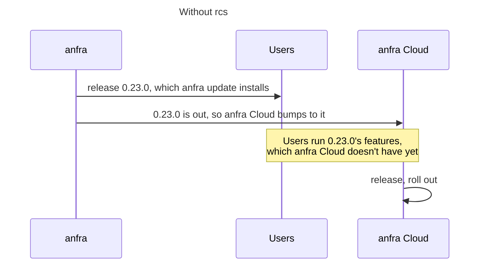
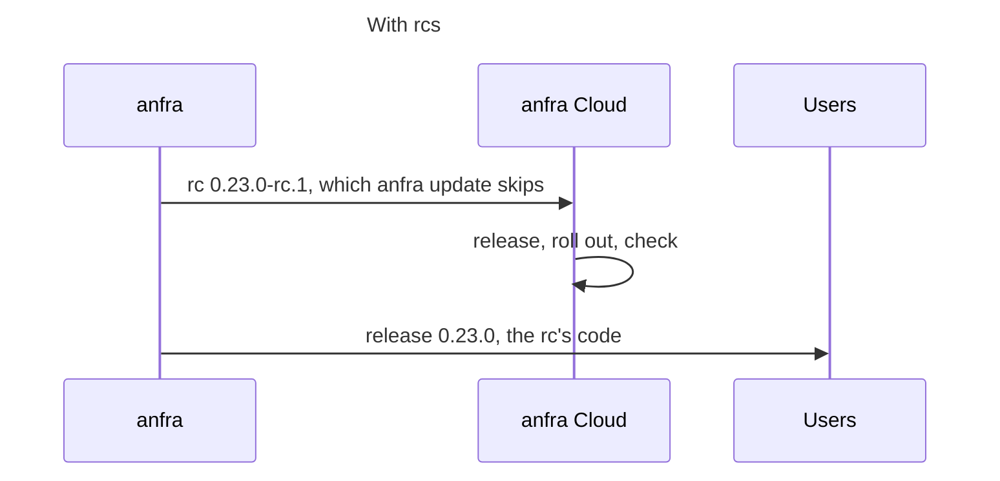
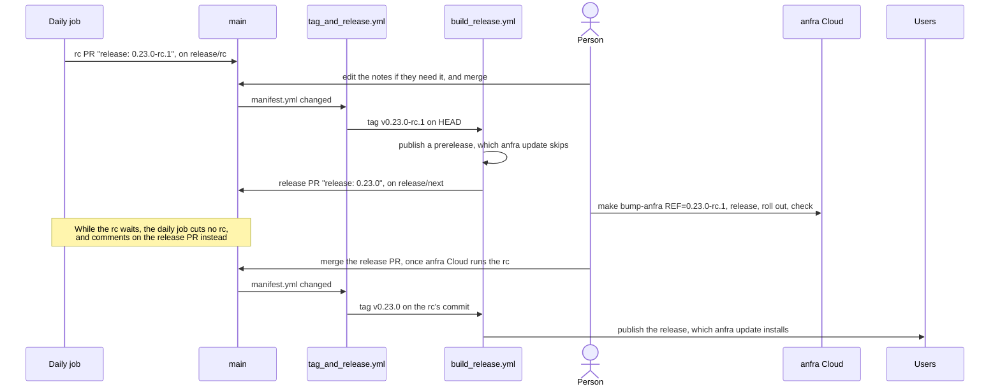
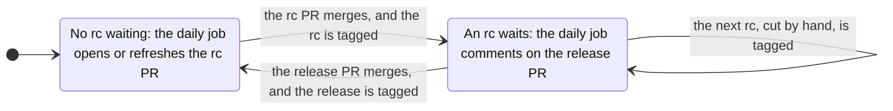
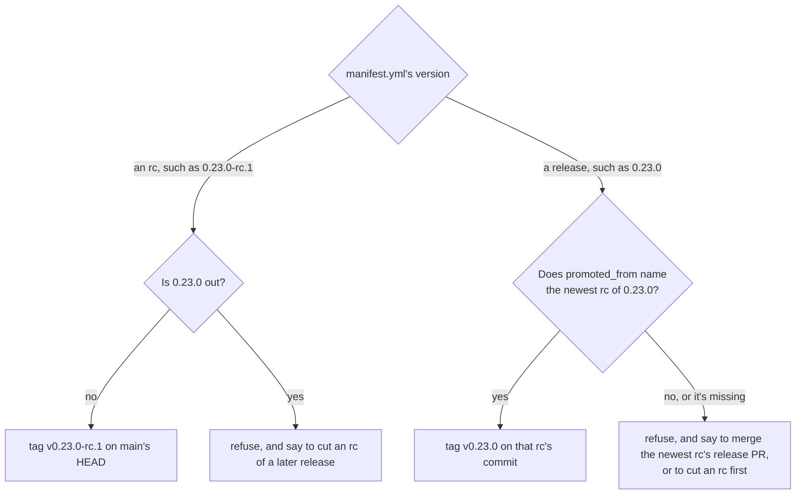
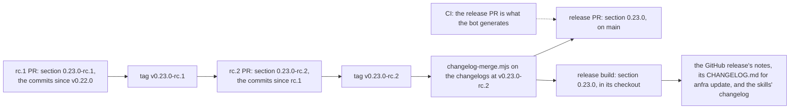

# Releases

A release is one `anfra` binary per platform, with its sidecars embedded as two binaries, anfra-node and anfra-canal ([sidecars.md](sidecars.md)) and the Data App frontend built in, plus a Docker image of the Linux ones and the SDK on npm. Everything about a release follows from one file.

Each release starts as a release candidate (rc), such as `0.23.0-rc.1`. anfra Cloud releases with the rc first, and only then does the same code go out as the release that users get, `0.23.0`.

## Why releases start as rcs

anfra Cloud runs anfra core as a Go module, and its web app uses anfra's SDK and design packages from npm. All three come from an anfra release, so a new anfra feature reaches anfra Cloud only after anfra has released it. Users have the release by then, because `anfra update` installs it as soon as it's out, so they could run a feature that anfra Cloud doesn't have yet:

An rc reverses the order. anfra Cloud gets the feature first, and users get it once anfra Cloud can handle it:

That takes three rules, which the rest of this doc follows:

- **Updates skip rcs** ([Updates](#updates)).
- **The release is the rc's commit** ([Tagging](#tagging)).
- **One release at a time** ([While an rc waits](#while-an-rc-waits)).

## `manifest.yml`, the single source

`manifest.yml` holds the `version`, the sidecar releases it embeds (`sidecars:`, a holistics-core release tag for anfra-node and a canal release tag for anfra-canal, with the canal-query and canal-lake releases it contains in `anfra_canal_services`, for deployments that run them as services of their own), and the cloud servers its `anfra auth login` offers (`cloud_servers:` and `cloud_support_email:`, which `scripts/cloud-url` checks and the build embeds; see [DEVELOPMENT.md](../../DEVELOPMENT.md#cloud-login-url)).

- **`version`** names the git tag (`v<version>`, which is also the Go module version of `github.com/holistics/anfra`; releases up to 0.8.0 were tagged `anfra-v<version>`, which Go does not read as a version). It's an rc's version, `0.23.0-rc.1`, from its rc PR, and the release's, `0.23.0`, from its release PR.
- **`promoted_from`** names the rc a release is made from, such as `0.23.0-rc.1`. The release PR adds it, and the next rc PR removes it. Until then it records where the release came from.

The build takes the version from the tag, not from `manifest.yml`: a release's tag is on its rc's commit, whose `manifest.yml` names the rc. It compiles the version into the binary, and names the image's tags and the npm packages' version with it, so they always agree with the tag.

## Making a release

Two pull requests make a release:

- **The rc PR,** `release: 0.23.0-rc.1`, cuts an rc. The daily job (`release_candidate_pr.yml`) opens it, and merging it tags the rc.
- **The release PR,** `release: 0.23.0`, releases an rc. The rc's build opens it, and merging it tags the rc's commit as the release.

For `0.23.0`, after `0.22.0`:

1. **The daily job opens the rc PR.** It sets the version in `manifest.yml`, `web/sdk/package.json` and `web/design/package.json`, and adds the rc's section to the changelogs. Edit the notes there if they need it, and merge it.
2. **`tag_and_release.yml` tags `v0.23.0-rc.1`,** and `build_release.yml` publishes it as a prerelease. Its build then opens the release PR.
3. **anfra Cloud releases with the rc:** `make bump-anfra REF=0.23.0-rc.1` there, then its own release and rollout. Check that the new features work on anfra Cloud.
4. **Merge the release PR once anfra Cloud runs the rc it names.** Nothing checks this, so the person merging decides.
5. **`tag_and_release.yml` tags the rc's commit `v0.23.0`,** and `build_release.yml` publishes the release. Users get it from `anfra update`, and anfra Cloud supports it already.
6. **The daily job starts again,** from the commits since `v0.23.0`. anfra Cloud can move its pin to `0.23.0` at any time, which changes no code.

### A feature's lifecycle

Features keep merging to `main` while an rc waits. Which release a feature goes out in depends on when it merges, not on when the release PR merges. Here, feat A merges before the rc PR, and feat B while the rc waits. Each column is a lane, named in the top row, and each row comes after the one above it. Each box is what a step produces: a commit on a branch, a tag, or a published release. The thick grey line in `main` is its history, oldest first: it shows the order the commits land in, and nothing flows along it.

- **feat A** is in the rc, so anfra Cloud runs it first, and users get it in 0.23.0.
- **feat B** misses the rc. It's on `main` before the release PR merges, but `v0.23.0` is on the rc's commit, so 0.23.0 doesn't have it ([Tagging](#tagging)). It goes out in the next rc, and reaches users in the release after. To get it into 0.23.0 instead, cut `0.23.0-rc.2` by hand. That rc holds everything on `main`, B included, anfra Cloud checks it again, and its release PR replaces rc.1's ([While an rc waits](#while-an-rc-waits)).

### The rc PR

`release_candidate_pr.yml` opens it Monday to Saturday at 05:00 UTC: it runs `pnpm bump <rc>` on a branch fresh from `main`, commits `release: <rc>`, and opens the pull request. The workflow only sets up and calls `scripts/release-pr.sh`, which `--dry-run` runs locally: everything but the push and the pull request, which it prints.

- **The version** is the next rc of the release the conventional commits since the last release call for (`scripts/next-version.mjs`), read as the changelog reads them: conventional-recommended-bump with the changelog's preset and types (`conventional-changelog.config.mjs`). A breaking change bumps the major, or the minor while below 1.0; a `feat` the minor; any other type the changelog shows (`fix`, `perf`, `build`, `security`) the patch. A type the changelog hides is not releasable; with only those since the last release, there is nothing to release. The rc's number is one more than the highest rc of that release tagged yet. `pnpm next-version` prints it; `pnpm bump next` bumps to it. `scripts/lib/versions.mjs` reads the tags for all of the release scripts: the last release, the rcs of a release, and the rc waiting for its release.
- **Its notes** are its section of `CHANGELOG.md`, `## [0.23.0-rc.1]`, with the commits since the newest tag, rc or release, and of `skills/CHANGELOG.md` when one of them changed the skills. Edit them in the rc PR. A later rc adds its own section, and leaves the earlier ones as they are ([Release notes](#release-notes)).
- **One pull request, always current.** It lives on one branch, `release/rc`, which each run rebuilds from `main` and force-pushes, closing the open pull request and opening a new one: GitHub notifies no one of an edit to a pull request, but a new one notifies its watchers. A run that finds `release/rc` holding this rc of the current `main` already changes nothing. So there is never more than one open, and it is never more than a day behind `main`. Edits to its notes are lost at the next run, so merge it the day you edit it. When there is nothing to release, the run closes it.
- **By hand,** from the Actions tab or `gh workflow run release_candidate_pr.yml`, with an optional `version` to cut instead of the computed rc, and an optional `branch`. A run by hand cuts the next rc even while one waits.
- **An rc that needs commits of its own,** sidecar pins say: run it with a new `branch` (`-f branch=release/0.19.0-rc.1`), which must not exist yet, and push them there. `release/rc` is the workflow's own: commits pushed onto it are lost at the next run.
- **CI does not start on its own** on the pull request, for now: the workflow opens it with its own `GITHUB_TOKEN`, and GitHub starts no workflow for what that token does. Approve its workflows, with the button GitHub shows on the pull request, to run CI; again after each run replaces it. A GitHub App's token would fix it; the workflow's header has the TODO. The same goes for the release PR.

### While an rc waits

An rc waits for its release while the highest `v*` tag is an rc.

While an rc waits, the daily job cuts no rc: changes merged in the meantime haven't been through anfra Cloud, so they wait for the next rc, after the release. Without the pause, the daily job would cut a new rc whenever `main` has something releasable, and anfra Cloud would have to bump, release, roll out and check each one before the release could merge. On an active `main`, users would never get the release.

- **A change that has to ship before the release** goes out in the next rc, cut by hand. It comes from `main`, so it includes everything merged since the rc, and anfra Cloud has to check all of it. Its build replaces the release PR with one for the new rc. If `main`'s commits now call for a bigger release, such as a `feat` after an rc of `0.22.1`, the next rc is `0.23.0-rc.1`, and `0.22.1` is never released.
- **Each daily run comments on the release PR,** when `main` has changes the changelog lists since the rc: which rc waits and since when, the changes it holds back, and what to do. A new comment notifies the pull request's watchers, which an edit wouldn't, and the run hides its comment of the day before as outdated.
- **A daily run fails when no release PR is open,** with a message to cut the next rc by hand or to reopen the release PR. Closing the release PR doesn't end the wait: an abandoned rc usually needs fixing, which the next rc does. Because the pause depends on tags only, a pull request closed by mistake can't start a new cycle on top of an rc that anfra Cloud may already run.
- **The wait ends when the release's tag is pushed.**

### The release PR

Once an rc is out, its build runs `scripts/release-pr.sh --release <rc>`, which runs `pnpm bump <release> <rc>` on a branch fresh from `main`, `release/next`, and opens the pull request, closing the one it replaces. It sets the three versions to the release, sets `promoted_from` to the rc, and replaces the rc sections of both changelogs with the release's ([Release notes](#release-notes)).

**It is exactly what the bot generates.** CI checks it (`scripts/check-release-pr.sh`, in the `release` job): it runs the same bump on the pull request's base, and fails unless the pull request's change is the generated one. That catches any other change: an unrelated file, a version edited by hand, or a reworded line in the merged notes, which would land on `main` but not in the release, whose build merges the notes from the rc's tag. Edit an rc's notes in its rc PR, or cut another rc. The check also fails once a newer rc of the release is out, since that rc's release PR replaces it. On an rc PR, it checks that the release isn't out yet, since a release that's out takes no more rcs.

### Tagging

`tag_and_release.yml` runs on a push to `main` that changes `manifest.yml`, one run at a time, in the order of the pushes. If the version has no tag yet, it tags it:

**A release is tagged on its rc's commit, not on `main`'s HEAD.** The release PR merges once anfra Cloud runs the rc, which takes days, and other PRs keep merging meanwhile. They land between the rc PR's commit and the release PR's commit, so `main`'s HEAD holds code anfra Cloud never ran. The rc's commit holds exactly what it ran, so `v0.23.0` and `v0.23.0-rc.1` point at the same commit. The release PR's commit only records the release on `main`: its version, `promoted_from`, and the merged changelog.

It pushes the tag with a deploy key (`ANFRA_DEPLOY_KEY`), and the push triggers `build_release.yml`. The deploy key is needed twice over: the repository's tag ruleset blocks creating release tags, and the workflow's own token cannot bypass it, while a deploy key can; and a tag pushed with the workflow's own token would not trigger another workflow. `build_release.yml` also runs on a tag pushed by hand, and on `workflow_dispatch`: dispatched on a tag (`gh workflow run build_release.yml --ref v<version>`), it releases that tag again; dispatched on a branch, it is a test build, which uploads artifacts and publishes nothing.

### Release notes

Each rc's section of the changelogs is written once, in its rc PR, from the commits since the tag before it. So each rc's GitHub release shows what changed since the previous rc, which is what anfra Cloud needs to check it, and edits made in one rc PR survive the next rc.

The release PR merges every rc section above the last release's into the release's section, `## [0.23.0]` (`scripts/changelog-merge.mjs`). That includes an rc of a smaller release: after `0.22.1-rc.1` and `0.23.0-rc.1`, the `0.23.0` section holds both.

- **Lines are kept as written.** Each `###` group (Features, Bug Fixes and so on) becomes one, with the rcs' lines under it, newest rc first, and the groups ordered as the changelog's config lists their types, breaking changes first. Any text an rc section has outside a group goes above the groups, newest rc first too.
- **The heading** links to the comparison with the last release, and takes the newest rc's date: the date of its code, the same whenever and wherever the merge runs.
- **It merges the sections as they are at the rc's tag,** not on `main`, and so does the release's build, on the rc's commit, before anything reads the changelogs. So the release PR, the release's build and its GitHub release all get the same notes from the same input.

A release's GitHub release shows its section of `CHANGELOG.md`, under "Changelog", followed by GitHub's own generated notes: the pull requests, new contributors and compare link (`scripts/release-notes.sh`, which also previews them locally). So a release says what the changelog says, and a re-run brings its notes back in line. The build uploads `CHANGELOG.md` too, which `anfra update` reads ([Updates](#updates)).

## The build

`build_release.yml`, in order:

1. **The frontend,** once: `pnpm build:web`, into `internal/appserve/dist`, which every target embeds. It fails without `dist/index.html`: a binary without its pages is a broken release.
2. **Checks,** before anything is built. An rc's tag matches its commit's `manifest.yml`, and so does its SDK's version. A release's tag is on the commit of the newest rc of that release, and the build merges that rc's changelog sections into the release's. Either way, `CHANGELOG.md` has a section for the version.
3. **The sidecars:** the pinned releases' binaries, downloaded from their repositories (a cross-repository read token, `ANFRA_DIST_TOKEN`).
4. **Every target,** cross-built on one runner (anfra is pure Go): each target's sidecars copied into the embed assets, `go build -tags embed_sidecar` with the tag's version injected, then gzipped. Only the `.gz` is published, as a transport compression: the sidecars embedded in the binary stay uncompressed, so the binary itself stays delta-friendly.
5. **The image,** below.
6. **The GitHub Release,** created (or, on a re-run, edited) with the binaries and `CHANGELOG.md`, which `anfra update` reads its notes from ([Updates](#updates)). An rc's is marked as a prerelease.
7. **The SDK,** once the release is out: below.
8. **The skills,** for a release: below.
9. **The release PR,** after an rc ([The release PR](#the-release-pr)).

## The Docker image

`ghcr.io/holistics/anfra`, built by `build_release.yml` from the `Dockerfile` at the root; how to run it is in [usage/docker.md](../usage/docker.md).

- **The release's own binaries.** The Linux binaries built above are laid out by platform as the build context (`image/<os>/<arch>/anfra`), so the image runs exactly what the release downloads.
- **One name for every platform.** Built for linux/amd64 and linux/arm64 at once, each tag is a multi-platform index; Docker pulls the build matching the machine. Tags are the version, its major.minor, and `latest`; a prerelease takes only its version, so the other two stay the latest release's. A release pushes them; any other build only builds the image, so a broken Dockerfile shows before a release does.
- **No emulation.** Everything that needs a shell (CA certificates, the user, tini) is prepared in a stage on the builder's own platform; the final stage only copies files. So building for another architecture needs no QEMU or Rosetta.
- **Debian trixie,** because the sidecars anfra unpacks need its glibc.
- **tini as PID 1** (Debian's static build, for the target architecture). It reaps orphans, forwards signals, and keeps anfra from being PID 1, which a sidecar could read as anfra having died ([sidecars.md](sidecars.md)).
- **A named user,** `anfra`, UID 1000. The sidecars look their user up, and fail without a passwd entry, so a bare UID will not do.
- **Its home already holds `~/.anfra` and `~/.cache`,** owned by `anfra`. An image built on this one may run root steps whose tools write to `$HOME/.cache` (Rosetta does, when building amd64 on Apple silicon); with those folders already anfra's, such a step only adds its own folder inside them, rather than leaving them root's and anfra unable to start.
- **`/repo`,** the working directory, owned by `anfra`: where a repo is mounted or copied.

## The SDK on npm

`@holistics/anfra-sdk` (`web/sdk`), published by `build_release.yml`'s `sdk` job; what it holds is in [data-apps.md](data-apps.md).

- **The release's version.** The SDK's API client is generated from this release's `api/openapi.yaml`, so the two go out together, at one version, even when the SDK did not change. `pnpm bump` sets both, and CI fails a pull request in which they differ. The build sets the package's version from the tag before it publishes, since a release's commit is its rc's, and an rc refuses to go out when its tag and its SDK's version differ.
- **Published once.** A re-run skips a version npm already has. A prerelease version (`1.2.0-rc.1`) is published under the `next` dist-tag, so `npm install` never picks it. A release moves `next` to itself, when the package has one, so `next` is never older than `latest`.
- **Trusted publishing.** npm takes the publish from the workflow over OIDC, with no token, and records the package's provenance. It is configured on the package's settings on npmjs.com, naming this repository and a workflow. npm checks the workflow that started the run: `build_release.yml`, which a tag push starts. There is no npm token, and the package's settings disallow tokens, so only this workflow, or a maintainer with two-factor authentication, can publish.
- **Any other build** packs it without publishing, so a broken package shows before a release does.

## The skills

The anfra skills' source is `skills/`; `build_release.yml`'s `skills` job publishes them to [holistics/anfra-skills](https://github.com/holistics/anfra-skills), the facade every agent installs from, after the binaries ([agent setup](agent-setup.md#releasing-the-skills)).

- **The release's version, only when they changed.** The job rebuilds what the facade holds, with the parameters it recorded (`.build.json`), and compares. The same tree publishes nothing; a different one is built at this release's version, committed, tagged `anfra-v<version>`, and pushed (`skills/scripts/publish.sh`). A re-run publishes nothing again.
- **Their changelog,** `skills/CHANGELOG.md`, gets a section from each rc PR when a commit since the tag before it changed `skills/`, and the release's section merged from those ([Release notes](#release-notes)). It is published with them.
- **The build writes the versions.** The manifests' versions and each skill's stamp come from the build (`skills/scripts/build.mjs`), not from `skills/`, so `pnpm bump` doesn't touch the skills.
- **A GitHub App** with Contents: write on the facade, allowed past its branch protection, does the push, with a token the job makes from `ANFRA_SKILLS_DEPLOYER_APP_ID` and `ANFRA_SKILLS_DEPLOYER_KEY`.
- **A prerelease doesn't publish them,** because `anfra update` checks their version on the facade, and they would reach everyone before the release does.
- **Any other build** reports what a release would publish, without pushing.

## Versions

A release's or an rc's version is its tag's, injected at build time (`internal/meta.Version`). Any other build is one from source, and says which: the release it comes after, then, as semver build metadata, the commit and whether the tree was dirty, as Go records them in the binary: `<base>+<commit>`, or `<base>+<commit>.dirty` (`internal/meta/version.go`). `make build` and `make dev` inject the base from `manifest.yml`, which is an rc's version while one waits; a bare `go build` reports `0.0.0+<commit>`.

Build metadata leaves the version's order alone, and a release never carries any, so its presence alone marks a build from source (`meta.FromSource`). That is what the updater relies on.

## Updates

`anfra update` replaces the running binary with the latest release, and anfra notices newer ones in the background: a cached check at most hourly, 10 minutes apart after one fails, a notice on an interactive terminal, an announcement from `serve` (`internal/update`, `cmd/anfra/update.go`). `ANFRA_NO_UPDATE_NOTIFIER` turns the notices off; `ANFRA_AUTO_UPDATE` applies updates in the background instead.

The latest release is the one GitHub's `/releases/latest` names, which skips a release marked as a prerelease. `build_release.yml` marks any version with a `-` as one, such as `0.23.0-rc.1`. `install.sh` follows the same link.

A running `anfra serve` keeps the version it started with, and so do the commands forwarded to it, until it is restarted. The CLI warns of one with a `server_version_mismatch` warning: a command forwarded to it before its answer, `anfra version`, which is never forwarded and reports the CLI's own version, and `anfra update` at its end, for each server still running another version ([cli-vs-warm-server.md](cli-vs-warm-server.md#version-mismatch)). An MCP client, which talks to the server alone, gets no such warning.

After an update, or before one with `anfra update check`, `anfra update` prints what the new version brings: the changelog of each release since the running one, the skipped ones included, read from the `CHANGELOG.md` the new version's release uploaded, of which each release's notes are a section, rather than from GitHub's rate-limited API (`internal/update/notes.go`). It isn't read at the release's tag, because a release tags its rc's commit, whose `CHANGELOG.md` has only the rc's sections. It shows the newest three and links to the rest. The notes are best-effort: when they can't be fetched, it prints a link to the releases instead, and the update still succeeds.

None of this applies to a build from source: it was built on purpose, and a release would replace it with something else. It is never told of updates, and `anfra update` refuses to replace it.
