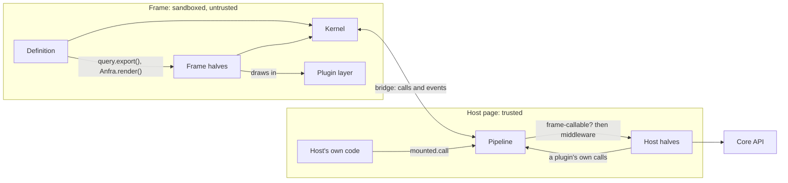
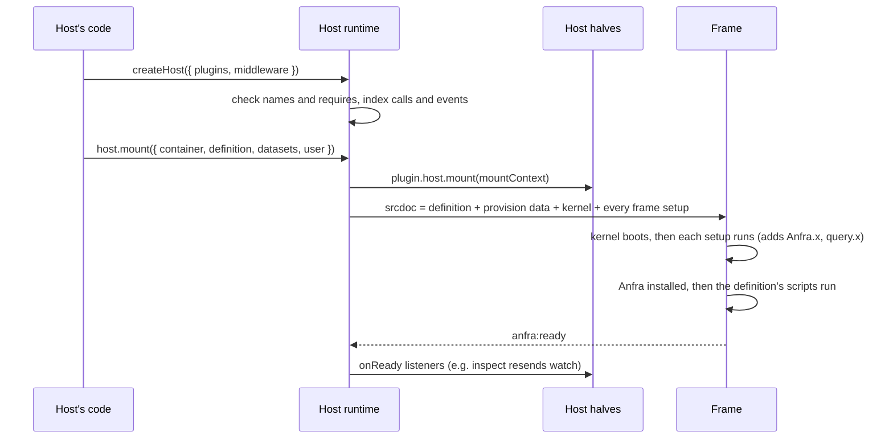
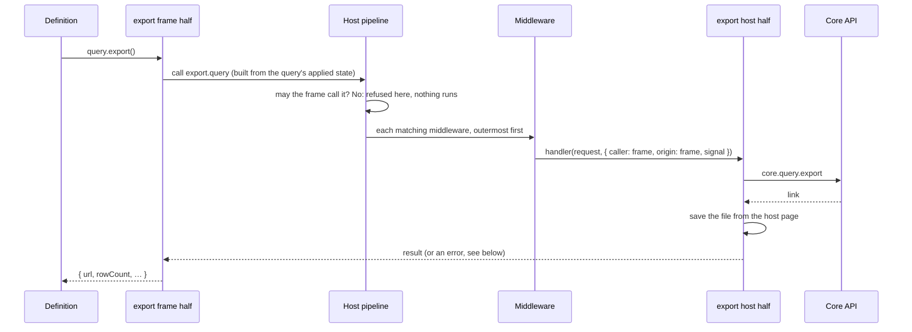
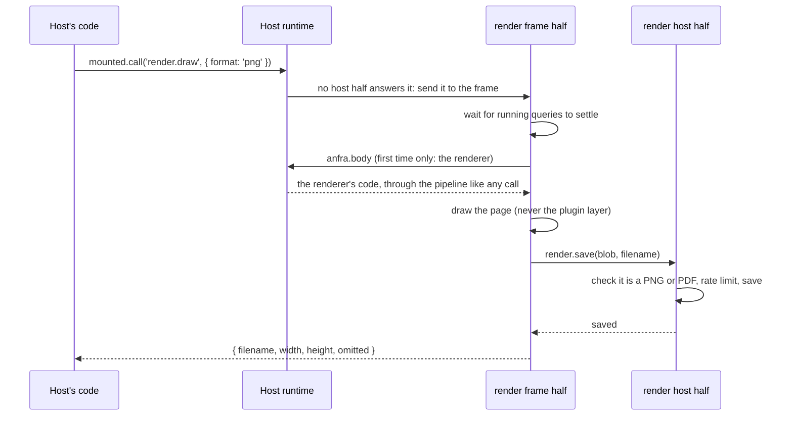
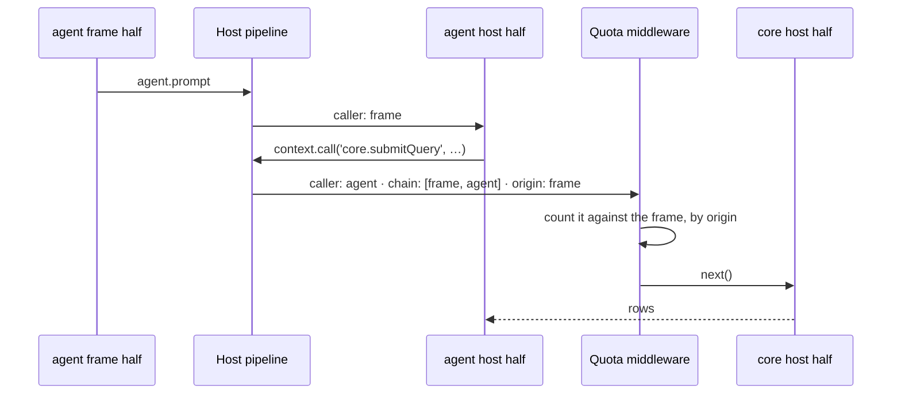
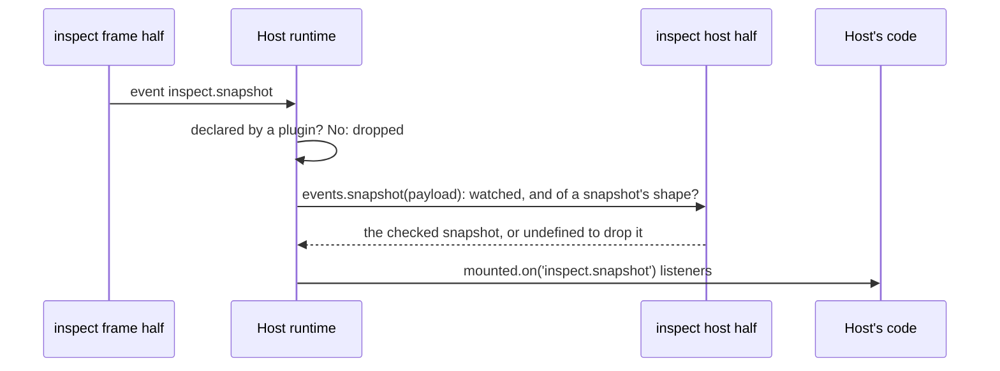

# SDK plugins

> Status: built. Streamed calls come next, then the AI agent plugin. How to write one: [usage/sdk-plugins.md](../usage/sdk-plugins.md). Where the code is: [Where it lives](#where-it-lives).

Everything a Data App reaches beyond its own page comes from an SDK plugin: running a query, an export, lineage, a rendering, the inspect panel's tabs. The name says SDK because the engine and appserve may get plugins of their own later.

The host installs plugins, and a definition can't bring its own. A plugin has up to two halves: a host half in the trusted host page, and a frame half in the sandboxed frame beside the definition. The halves talk in calls (a request and an answer) and events (a notice), named `<plugin>.<name>`. Every call to the host goes through one pipeline, where middleware can watch or change it.

## Words used here

| Word | Means |
|---|---|
| SDK plugin (plugin, here) | A named feature a host installs on its Data Apps: a host half, a frame half, or both. |
| Host half | The plugin's code in the host page. It answers the plugin's calls. Trusted with everything the page has. |
| Frame half | The plugin's code in the frame: the API it adds for the author, the calls it answers for the host, the UI it draws. Trusted by nothing. |
| Kernel | What every frame runs, plugin or not: the bridge, the app model (`App`, `Query`, controls, structure) and `Anfra`. |
| Host runtime | One per host page (`createHost`): the installed plugins and middleware, and the frames mounted into it. |
| Plugin call | A request a plugin answers, `<plugin>.<name>`. The frame, the host or a plugin makes it. |
| Event | A notice nobody answers, `<plugin>.<name>`, either way across the bridge. |
| Pipeline | The one path every call to a host half takes: the frame-callable check, then middleware, then the handler. |
| Middleware | Code around calls, chosen by name, that can watch, change, answer or refuse them. |
| Origin | Who started a call: the frame or the host, however many plugins it passed through. |
| Plugin layer | Where frame halves draw: a layer above the definition's page, never in it. |
| Contribution | UI a plugin, or the host, adds to the host page as data: a command or a tab. The host draws it. |
| Panel | One per mounted Data App: the host's devtools over it, whose tabs plugins add. |

## What a plugin is

| Half | Runs in | Does |
|---|---|---|
| Host half | the host page | Answers the plugin's calls: reaches the core API, saves a file, keeps state across frames. Declares the events it accepts from a frame. |
| Frame half | the frame | Adds API for the author (`query.export()`), answers the calls the host makes into the frame, draws in the plugin layer. |

Either half may be missing: `core` has no frame half, and a theming plugin might have no host half.

The host installs plugins, and a definition can't bring its own. A definition is untrusted ([security.md](security.md)) and carries no SDK version ([data-apps.md](data-apps.md#why-one-html-file)), so letting it pick plugins would mean deciding what a definition may load and negotiating versions.

anfra's own features are plugins too, built with the same API a host uses. That holds the API to what anfra itself needs.

## What isn't a plugin: the kernel

The kernel is the plumbing (the bridge, ids and cancelling, the sandbox, provisioning, the plugin runtime) and the app model (`App`, `Query`, controls, cross-filters, structure, `locate()`). No Data App exists without the app model, so it stays out of the plugins.

Every call that crosses the bridge is a plugin's, including running a query. anfra ships five plugins:

| Plugin | Calls | Events from the frame | Adds for the author |
|---|---|---|---|
| `core` | `core.submitQuery`, `core.fieldSuggestions` (frame may call) | | nothing: the app model is its frame side. Required. |
| `export` | `export.query` (frame may call): makes the file, saves it from the host page | | `query.export()` |
| `lineage` | `lineage.trace` (frame may call); the panel's Lineage tab, a canvas of where the page's numbers come from, which pins the card a selection holds | | `Anfra.lineage()` |
| `render` | `render.save` (frame may call): checks the bytes, rate-limited; `render.draw` (answered in the frame, for the host); `render.download` (host only): `render.draw`, one at a time, its commands disabled meanwhile | | `Anfra.render()`. The renderer is its body. Commands: Download as PNG, as PDF (`overflow`). |
| `inspect` | none: the panel's Overview, Data, Queries, Structure and Declaration tabs, and the Inspect command (`Alt+Shift+I`); a middleware logs each mount's frame calls for them | | nothing |

`core` is required, and the host always names it: `corePlugin(coreApiBackend(api, { datasets }))`. The app model runs its queries by calling `core.submitQuery` through the pipeline like any other caller, so a host swaps or wraps queries the way it would any plugin's calls, with another `core` or with middleware. The SDK has no default `core` because it can't know where a host's core API is.

## How the pieces talk

### Mounting a Data App

The bridge is served before the document loads, so no call is missed. The kernel and the setups run inside one function, so none of them is left on the frame's window. A setup that throws is logged and skipped; the rest run.

### The frame makes a call

Cancelling: the frame aborts its signal, the bridge sends `anfra:cancel`, and the handler's `signal` aborts. Nothing answers a cancelled call.

### The host makes a call into the frame

A call whose name no host half answers goes to the frame, where a frame half answers it. `render.draw` from appserve's toolbar:

The host treats what the frame answers as untrusted: the definition shares the frame half's realm.

### A plugin makes a call for the frame

A host half calls other plugins through the same pipeline, so middleware sees those calls too. The call keeps who started it:

### The frame sends an event

## The rules

### Who may call what

A call is host-only unless its plugin lets the frame make it (`frame: true`). The pipeline refuses a frame call to a host-only call before any middleware or handler runs. Whatever the frame can call, the definition can call too, since frame halves share its realm, so a call meant for the host (one that spends the host's credentials, say) only becomes reachable when its plugin opens it on purpose.

Every call carries who made it (`caller`) and who started it (`origin`, with every hop between in `chain`). A query an agent plugin runs for the reader's prompt has the agent as its caller and the frame as its origin. A quota that counts calls made by the frame would miss that query; one that counts by origin catches it.

A plugin that forwards a call name or request the frame chose makes the call with `{ asOrigin: true }`. The pipeline then refuses it if the frame couldn't make it itself, so the plugin can't be used as the frame's deputy for a host-only call. This is opt-in because a plugin's own calls, such as the one that spends the host's model key, are its to make whoever asked.

### What crosses back

When a call fails, the frame gets the error's class and message only for the SDK's classes (`ValidationError`, `QueryError`, `PermissionError`, `TransportError`), whose messages are written for an author. Any other error arrives as `QueryError: The call failed.`, because a message from a bug, a middleware or a library may hold a URL, an id or a server's error.

A frame's event reaches the host only if a plugin declared it in `host.events`, and only in the form that plugin's check returns. The definition makes up an event's payload just as it makes up a call's request, and the plugin that owns the event checks its shape once, so each host's listeners don't have to.

### Middleware

Middleware wraps calls chosen by name (`*`, `core.*`, `core.submitQuery`). Each layer gets the request, the call's context and `next`, and may change the request, answer instead of the plugin, refuse the call, or change the answer.

Its order comes from `stage`, then name. Registration order would be simpler, but every system surveyed for this design (Rollup, Vite, Tapable, Fastify) ended up adding explicit ordering once array position stopped being enough. Each call keeps a trace of the layers it passed through, for debugging.

Middleware serves the page: logging, a request id, a cache, masking, a platform checking quota before a call leaves the page. Enforcement belongs on the platform's server.

A plugin's middleware sees every call on the page, and its host half has everything the page has, so installing a plugin trusts it with the whole page. Its frame half runs beside the definition and is trusted by nothing.

### State

The SDK persists nothing, and a host runtime lives as long as its page. A plugin whose state must outlive the page takes a store from the host, through an interface the plugin defines, because who the reader is and where their data lives is the platform's business ([data-apps.md](data-apps.md#what-is-cores-and-what-is-a-platforms)).

## Plugin UI

A plugin's UI about the host goes in the host's own chrome, as **contributions**: data the host draws its own way, in Vue, React or anything else. The SDK ships no chrome. UI about the page's content (a highlight, a modal, a menu on a block) is drawn in the frame's plugin layer instead, since the gesture, the anchor and the app's state are all there.

| Contribution | What it is | The host |
|---|---|---|
| Command | `{ id, title, icon?, placement?, shortcut?, run, state? }`: runs a call, or opens the panel at a tab. | Lists `host.commands` in its action bar or palette, shows `mounted.commandState(id)` (pressed, or disabled with a reason), and calls `mounted.run(id)`. |
| Tab | `{ id, title, icon?, order?, mount(root, context) }`: a view in the panel. | Lists `host.tabs` in its panel's tab strip and calls `mounted.panel.mountTab(id, element)` for the open one. |

A plugin's contributions are named under it (`inspect.toggle`); the host's own (`createHost({ commands, tabs })`) keep the id they are given. `createHost({ contributions })` is a filter: what it refuses is left out everywhere, while the plugin's calls stay, so a host can build its own UI on them instead.

**The panel** belongs to the runtime, one per mount (`mounted.panel`): whether it is open, the tab it shows, the node selected (one, shared by every tab), the frame's snapshot while open, and pick mode. The frame's side of it (the snapshot, pick, highlight and locate) is the kernel's, under `anfra.*`, so a tab from any plugin has it without `inspect`. A tab draws into a shadow root in the host page, with any framework or none, and makes calls through its `context` as its plugin, so middleware sees them. Its `context.mount` is the mount's `MountContext`, with the reader and datasets the frame is provisioned with, which a plugin keys what it keeps about the frame by (`inspect` keeps the frame's request log there, filled by its middleware). It is loaded when first shown.

**The theme** is a scheme and nine tokens (`--anfra-color-bg`, `-fg`, `-muted`, `-border`, `-accent`, `-danger`, `--anfra-radius`, `--anfra-font`, `--anfra-font-mono`). A host sets them once (`createHost({ theme })`, `host.setTheme`), mapped from its own design tokens. The runtime sets them on each tab's element and sends them to each frame (`anfra.theme`), where they go on the plugin layer and on `Anfra.theme`, which a definition may read. They are never applied to the definition's page.

**The menu on the page's content.** A right-click on a marked block opens a menu of what plugins and the host offer for it; so does `query.menu(event, rows, { fields })`, which the definition calls from its chart's own right-click handler with the rows under the pointer, as it would `query.select`. The SDK derives the rows' dimension conditions as a cross-filter's, and the target carries the block the rows are in, whose entries follow the rows'. A frame half adds entries with `kernel.menuItem({ id, label, target: 'node' | 'rows', when?, run })`; a host's command with a `target` joins them: the frame asks the host for its entries for each target (`anfra.menu`) and runs the one picked (`anfra.run`), as a call the frame started. A frame `when` is presentation only; a host's `when` and `state` decide on a target it checked only for its shape.

The runtime leaves right-click alone until something offers an entry, and always when the page handled the event itself (it prevented the default), with Shift (the browser's menu), and on a block marked `data-anfra-menu="off"`. One menu, modal or popover is open at a time; frame halves open the other two with `kernel.modal` and `kernel.popover`, drawn by the runtime (backdrop, focus, Escape, scroll lock, placement) with the plugin's content in its own shadow root. What draws all three is the kernel's UI body, sent on first use like a plugin's.

**Shortcuts**: a command's `shortcut` runs it from the host's page (`mounted.handleKeydown(event)`, from the host's own key handler) and from inside the frame, which forwards the combinations the host registered (`anfra.shortcuts`, `anfra.shortcut`). A key the page handled itself (`preventDefault`) is left to it.

## The frame side

A frame half goes into an opaque-origin frame, so it is script source, in two parts:

- The setup is inlined into the frame's document and runs before the definition, in install order. It adds the plugin's API and answers the host's calls. Running first is what puts `Anfra.lineage` in place before the definition's first script.
- The body is optional and is fetched on first use with the kernel's call `anfra.body`, so frames that never use the plugin never carry it. The renderer is a body.

A setup gets the kernel (`FrameKernel`): the SDK and its apps, the error classes, the overlay and the page's structure, its calls and events, its place in the plugin layer, and its body. It hears of each app the definition creates through `onApp`, and of each change through the app's own `subscribe`. Plugins can't define hooks of their own in the frame, since the definition loads after them and can patch anything in that realm.

Frame halves don't depend on each other; what they share comes from the kernel. That keeps install order safe and the frame free of a dependency graph.

A frame half adds API only under its own name: `Anfra.<plugin>`, `query.<plugin>`, `control.<plugin>`. Two plugins can't collide, and someone reading a definition can tell which plugin a call needs.

A plugin that isn't installed adds nothing. Its members are missing, where a stub would reject, because the kernel knows no plugin by name and couldn't stub one written after it. A definition checks with `Anfra.plugins.has(name)`, or checks the member itself.

Plugins draw only in the plugin layer, which sits above the definition's page, with each plugin in its own shadow root. They never touch the definition's markup, since the author owns the page. The shadow roots keep styles from crossing in either direction, and a rendering leaves the whole layer out, which is how a picture never shows inspect's overlay. UI that doesn't need the page's layout, such as a chat panel, belongs in the host's own page.

### Types

One registry, `AnfraPlugins`, maps each plugin's name to what it adds (`anfra`, `query`, `control`). `Sdk`, `Query` and `Control` take their plugin members from it, each optional, as at runtime. A plugin outside the SDK adds its entry by module augmentation ([usage](../usage/sdk-plugins.md#5-types)).

Checking the member narrows it: `if (Anfra.render)` and `query.export?.()` type-check. `Anfra.plugins.has` completes plugin names but narrows nothing, since a check on one object can't make another object's member present.

Two things could come later. A host could declare the plugins it always installs, so their members become required. And someone has to decide where TypeScript gets compiled, since a definition is plain scripts; that touches "nothing to build" ([data-apps.md](data-apps.md#why-one-html-file)) and needs its own decision.

## Packaging

anfra's plugins are `@holistics/anfra-sdk/plugins`, released with the kernel. A host carries the frame halves it was built with, as it carries the kernel, so the frame and the host always match.

A plugin outside the SDK is the same object, `{ name, version, requires, host, frame }`, made with `definePlugin` and built with `buildFrameHalf` (`@holistics/anfra-sdk/build`), which refuses a frame half that bundles the API client or the host's code. It is tested with `@holistics/anfra-sdk/testing`. All of it is in the [usage guide](../usage/sdk-plugins.md).

## Where it lives

| What | Where (`web/sdk/src/`) |
|---|---|
| Host runtime: install, pipeline, middleware, mounting | `host/runtime.ts`, `host/plugin.ts` |
| The bridge, both sides | `common/bridge.ts`, `common/endpoint.ts` |
| The frame's kernel: bootstrap, the kernel plugins get, the layer | `app/bootstrap.ts`, `app/kernel.ts`, `app/layer.ts`, `app/extensions.ts` |
| Types registry | `app/pluginTypes.ts` |
| anfra's plugins | `plugins/<name>/index.ts` (host half), `frame.ts` (setup), `body.ts`; `inspect`'s tabs in `plugins/inspect/tabs/`, what they derive in `plugins/inspect/model/` |
| Contributions, the panel, the theme | `host/contributions.ts`, `host/panel.ts`, `common/theme.ts`, `common/shortcut.ts`; the frame's side in `app/inspection.ts` and `app/bootstrap.ts` |
| How a frame half is built: the SDK's own, and anyone's | `tsup.config.ts`, `build/index.ts` |
| Testing helpers | `testing/` |
| A worked example | `web/sdk/examples/notes/` |

## What was decided against

- Services (cordis, Koishi, Fastify's decorators), where plugins hand each other objects. Every use of another plugin would bypass middleware, and a platform's quota would miss the queries an agent runs.
- Plugin-defined hooks (Tapable, Rollup). Middleware covers the host, and in the frame a hook enforces nothing. Fan-out, such as many plugins adding tools to an agent, will get an extension point the agent plugin owns, decided with that plugin.
- Hot reload. Plugins are installed when a page loads.
- Scoping a plugin's middleware to its own calls. A plugin's host half could make any call itself, so a scope would look like a boundary without being one. A host that trusts a plugin less shouldn't install it.
- Plugins adding to the definition's markup, such as a "view data" button on every block. The page is the author's; if that's wanted, an attribute the author writes can opt a block in.
- The host drawing UI about the page's content (a menu on a chart's point, a "view data" modal), as Power BI, Tableau and Looker do for their sandboxed visuals. Each of them is one host; anfra's plugins must work in hosts nobody here writes, with no work from them. Drawing in the frame needs no positioning across its edge and keeps the app's state where it is. The cost: such UI stays inside the frame's box.
- The SDK shipping host chrome (a panel drawer, an action bar, a palette). Each is simple for a host to build from `host.commands`, `host.tabs` and `mounted.panel`, and every host would want its own look.
- Definitions declaring the plugins they need, refused at mount when one is missing. It can be added if hosts want it.

What these choices cost: anything that can't cross a call, such as a live object or a hook into each render, can't be shared between plugins.
